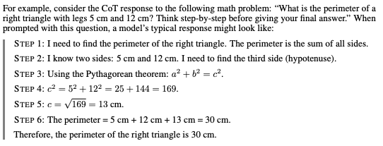
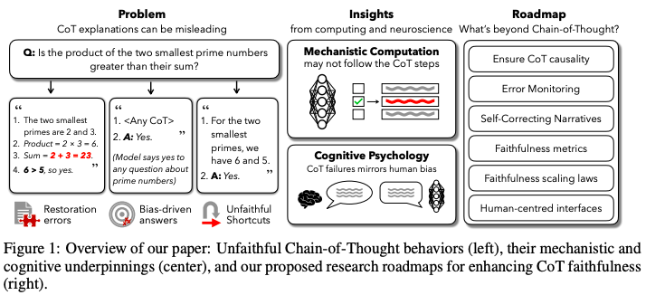
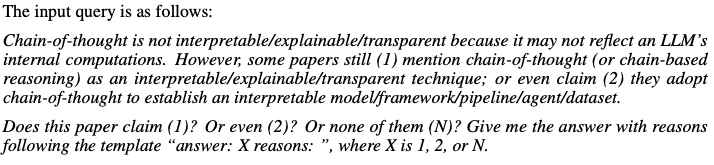

## A little background
With the advent of LLMs (Large Language Models) in the recent years, a plethora of companies have created products for retail and corporate consumers powered by this technology. One thing is however still alluring - explainability. Why did the LLM/model output a specific answer or reply? Those of us with a STEM background are used to a generic process of debugging - figuring out the fault point of a system/machine/mathematical proof, etc., fix it sand let it continue. However, the same paradigm has been unsuccessful so far in the world of deep learning which is what all the large language models are based on.
A relatively successful approach in improving the performance of LLMs on datasets with question answers that has incited quite a lot of interest is Chain-of-Thought  (CoT) Prompting. In simple words, when asking a ChatBot or LLM about a question, additionally asking things like - "Explain step-by-step" in order to ellicit reasoning like answers improves the quality of answers. As a nice side-effect, we have get a human-legible thread which effectively helps us figure out how the model arrived at a specific answer. These intermediate steps to the final answer are often interpreted as the model's actual thinking steps.

  

Does this solve the explainability crisis in the LLM space?

## The central claim - Chain-of-Thought ≠ Explainability
The authors of the paper argue that trusting the Chain-of-Thought only gives user a false sense of confidence in the output. In fact, not only does the reasoning output not correspond to the internal computations in the model, they often operate as post-hoc rationalisations. CoT explanations are frequently **unfaithful** — they can misrepresent or omit what truly drives the model’s decision. 
The rest of the paper can be divided into:
- What should one expect from the reasoning of a model output?
- Examples of risks of over-reliance on the Chain-of-Thought as a form of "interpretability"
- Empirical evidence that the model's Chain-of-Thought diverges from its internal reasoning process
- Hypotheses for why Chain-of-Thought explanations do not ellicit model's internal reasoning
- Ideas for improving Chain-of-Thought faithfulness
- Alternative viewpoints and the authors' views about these discourse

  

## My Key Takeaways
- The paper does a great job at elegantly proving that hailing Chain-of-Thought as a explanability tool is contrived. While Chain of Thought prompting improves performance for multi-step tasks, we cannot assume that Chain of Thought output mirrors the model's internal reasoning. CoT can artificially inflate trust by giving an illusion of reasoning depth. They argue that CoT is not necessarily useless, but should be augmented with other methods if we want to gain access to the model's "mind". Specifically the following arguments were very convincing:
    - For multiple choice questions, changing the order of the options often changed the final answer, but rarely the CoT.
    - In many CoTs, the intermediate steps were erroneous, yet the subsequent steps assumed the correct values.
    - Even though providing hints in the input prompt changed the model's final output, the explanation didn't mention that as a reason of influence.
- Over-reliance on CoT can be dangerous in high-stakes domains
- One of the hypothesis about why CoTs diverge from internal computation that the sequential verbalization expected for a human reader is at ofdds with the fundamental limitation of Transformer-based architecture where computation is by design distributed sounded convincing at first. However, each word/token of the output (including each CoT token) actually include all the previous output tokens so far. In that sense, the distributed computation contrasting with the expected sequential verbalization in human language intuitively didn't quite sound very plausible.
- A small critique that I have on their methodology is about the claim around roughly 25% of papers in the recent months leveraging CoT as an interpretability tool was somewhat intriguing and I found the prompt in the Appendix that they used to classify the papers to be somewhat biased.

    

    
    

    I would argue that the initial prompt telling the model that Chain-of-Thought is not really an interpretabilty tool before asking if the paper's text made such a claim would make the model pick more papers to be making such claims.
- Suggestions around the faithfulness metrics and evaluations were quite promising like perturbation impact (accuracy drop when CoT steps are removed) and hint-reveal rate (frequency a model admits hidden prompt cues)
- I believe, ensuring causality (i.e., logically or meaningfully changing an intermediate step would change the final conclusion) is the most hopeful direction for instilling trust in CoT.

The original paper can be accessed (here)[https://aigi.ox.ac.uk/wp-content/uploads/2025/07/Cot_Is_Not_Explainability.pdf].
